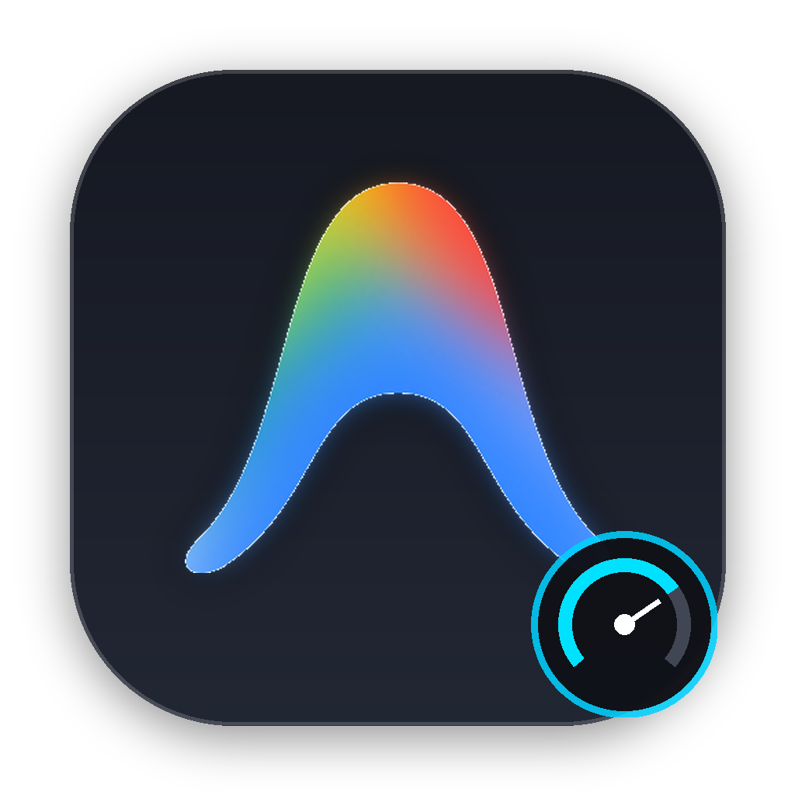
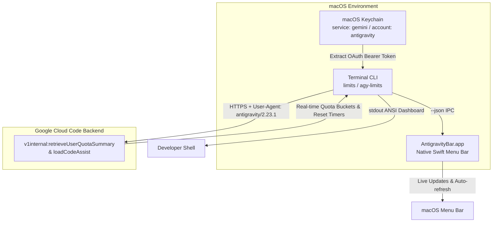

<p align="center">
  
</p>

<h1 align="center">AntigravityBar</h1>

<p align="center">
  <strong>Instant quota & rate-limit monitoring for Google Antigravity.</strong><br>
  A lightweight native macOS menu bar companion + a sub-second CLI utility.
</p>

<p align="center">
  <a href="#installation"></a>
  <a href="#architecture"></a>
  <a href="#cli-usage"></a>
  <a href="#features"></a>
  <a href="LICENSE"></a>
</p>

---

## 💡 Why AntigravityBar?

[Google Antigravity](https://antigravity.google) is a powerful agentic development workstation, but it is a heavy Electron environment. When you're deep in the zone inside your code editor or terminal, switching to the desktop app and digging through menus just to check whether your **Claude/GPT weekly limit** or **Gemini 5-hour quota** has refreshed breaks flow.

**AntigravityBar** gives you that visibility instantly:
- **At a glance in your macOS Menu Bar:** Live remaining percentages and reset countdowns always visible.
- **In your Terminal in ~0.6s:** Type `limits` anywhere for clean visual progress bars, or feed `--short` directly into your `tmux` statusline or Starship prompt.

---

## ⚡ Key Features

- **🎯 Exact Antigravity Parity**: Real-time breakdown of all quota pools:
  - **Gemini Models** (Gemini Flash, Gemini Pro) across 5-hour and weekly windows.
  - **Claude and GPT Models** (Claude 3.5 Sonnet, Opus, GPT-OSS) with paused-state detection and countdown timers.
  - **Plan Tier & AI Credits** (Google AI Pro, Enterprise, or Free tiers).
- **🍎 Apple HIG Compliant**: Native Swift menu bar app using dynamic template icons (`@1x` and `@2x` Retina), dark/light mode responsiveness, and complete macOS icon set (16px to 1024px).
- **🔒 Zero Configuration & Private**: Reads active session tokens directly from your local **macOS Keychain** (`service: "gemini"`). No credentials to type, no config files to manage, and zero data leaves your machine except direct HTTPS calls to Google Cloud Code endpoints.
- **🚀 Ultra Lightweight**: Sits quietly at **0% idle CPU** and under **15MB RAM**—no Electron, no web views, no background daemons.
- **💻 First-Class CLI (`limits`)**: ANSI color-coded bars, `--short` one-liner output, and `--json` format for scripting.

---

## 🖥️ Preview

### Terminal CLI (`limits`)

```text
✦ Antigravity Usage Limits (Google AI Pro · user@example.com)
Available AI Credits: 0
────────────────────────────────────────────────────────
 Gemini Models Models within this group: Gemini Flash, Gemini Pro
  Weekly Limit Remaining     [████████████░░░░]  76%  resets in 5d 21h
  Five Hour Limit Remaining  [████████████░░░░]  76%  resets in 3h 34m

 Claude and GPT models Models within this group: Claude Opus, Claude Sonnet, GPT-OSS
  Weekly Limit Remaining     [░░░░░░░░░░░░░░░░]   0%  resets in 8h 20m
  Five Hour Limit Remaining  [████████████████] 100%  (paused)

────────────────────────────────────────────────────────
```

### macOS Menu Bar Dropdown

```text
 ⌁ G: 76% (3h 34m) | C: 0% (8h 20m)
 ┌──────────────────────────────────────────────────┐
 │ 👤 user@example.com                              │
 │ ✦ Plan: Google AI Pro                            │
 │ 💰 Available AI Credits: 0                       │
 ├──────────────────────────────────────────────────┤
 │ Gemini Models                                    │
 │   • Weekly Limit Remaining: 76% (Resets in 5d)   │
 │   • Five Hour Limit Remaining: 76% (Resets in 3h)│
 ├──────────────────────────────────────────────────┤
 │ Claude and GPT models                            │
 │   • Weekly Limit Remaining: 0% (Resets in 8h 20m)│
 │   • Five Hour Limit Remaining: 100% (Paused)     │
 ├──────────────────────────────────────────────────┤
 │ Refresh Now                                   ⌘R │
 │ Quit                                          ⌘Q │
 └──────────────────────────────────────────────────┘
```

---

## 📦 Installation

### Quick Build & Install (Recommended)

Clone the repository and run the automated build script:

```bash
git clone https://github.com/VeeraChandu/AntigravityBar.git
cd AntigravityBar
chmod +x build.sh
./build.sh
```

What `build.sh` does automatically:
1. Compiles the native Swift executable with `-O` optimizations.
2. Bundles the macOS App bundle (`/Applications/AntigravityBar.app`) with full Apple HIG icon scale sets.
3. Ad-hoc codesigns the app bundle and registers it with macOS `LaunchServices`.
4. Installs the CLI utility to `~/.local/bin/agy-limits` and creates convenient symlinks: `limits` and `antigravity-limits`.

> **Note:** Make sure `~/.local/bin` is in your shell `PATH`:
> ```bash
> echo 'export PATH="$HOME/.local/bin:$PATH"' >> ~/.zshrc
> source ~/.zshrc
> ```

---

## ⌨️ CLI Usage

The CLI tool is ready immediately after running `./build.sh`:

```bash
# Full formatted dashboard with progress bars
limits

# Compact one-liner (ideal for status bars, tmux, starship)
limits --short

# Structured JSON output (for scripts, Alfred, Raycast)
limits --json

# Plain output without ANSI colors
limits --no-color
```

### Tmux Statusline Integration

Add your remaining quota right into your `~/.tmux.conf`:

```tmux
set -g status-right '#(limits --short) | %H:%M'
set -g status-interval 180
```

### Starship Prompt Integration

Add a custom command in `~/.config/starship.toml`:

```toml
[custom.antigravity]
command = "limits --short"
when = "command -v limits"
style = "bold cyan"
format = "[$symbol($output)]($style) "
symbol = "✦ "
```

---

## 🏗️ Architecture & How It Works



1. **Local Authentication**: Antigravity persists its session in the macOS Keychain under `service: "gemini"`, `account: "antigravity"`. AntigravityBar reads the `go-keyring-base64` payload directly using Apple's `security` framework, decrypting access and identity claims without requiring hardcoded secrets or web logins.
2. **Quota Ingestion**: Queries Google Cloud Code's internal endpoint (`daily-cloudcode-pa.googleapis.com/v1internal:retrieveUserQuotaSummary`) alongside `loadCodeAssist`.
3. **Session Auto-Refresh**: If an access token expires, AntigravityBar invokes a headless token renewal probe to keep the status bar live seamlessly.

---

## 🔒 Privacy & Security

- **No Remote Telemetry**: AntigravityBar has zero tracking, zero external metrics servers, and no analytics.
- **Local Credentials**: Credentials never touch disk in plaintext; they are read ephemerally from macOS Keychain memory.
- **Direct Traffic**: Network traffic flows directly between your machine (`urllib` / Apple Foundation) and Google's official Cloud Code endpoints over HTTPS.

---

## 🛠️ Troubleshooting

<details>
<summary><strong>"Error: Could not find or refresh Antigravity authentication token"</strong></summary>

Ensure you have launched Google Antigravity at least once and logged into your Google account. Verify that your Keychain has the record:
```bash
security find-generic-password -s gemini -a antigravity
```
</details>

<details>
<summary><strong>"command not found: limits"</strong></summary>

Add `~/.local/bin` to your environment path:
```bash
echo 'export PATH="$HOME/.local/bin:$PATH"' >> ~/.zshrc
source ~/.zshrc
```
</details>

<details>
<summary><strong>How do I start AntigravityBar automatically on macOS login?</strong></summary>

Go to **System Settings → General → Login Items** and add `AntigravityBar.app` from your `/Applications` folder.
</details>

---

## 📄 License

Distributed under the **MIT License**. See [`LICENSE`](LICENSE) for details.

---

<p align="center">
  Crafted with care for developers who love staying in the zone. ⚡
</p>
